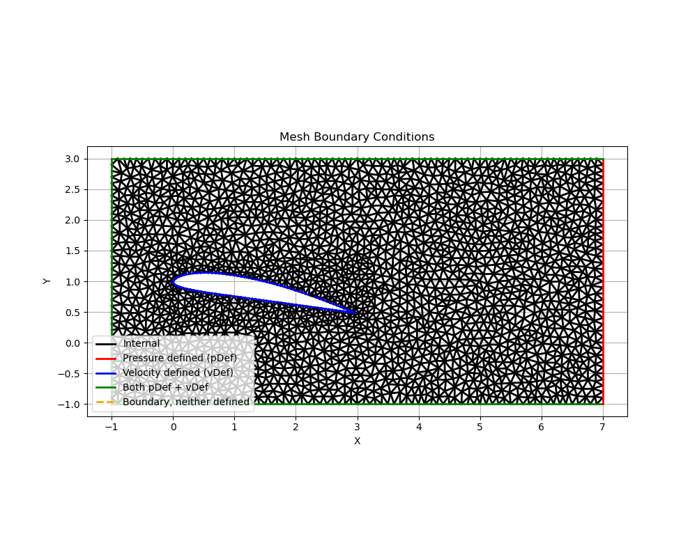
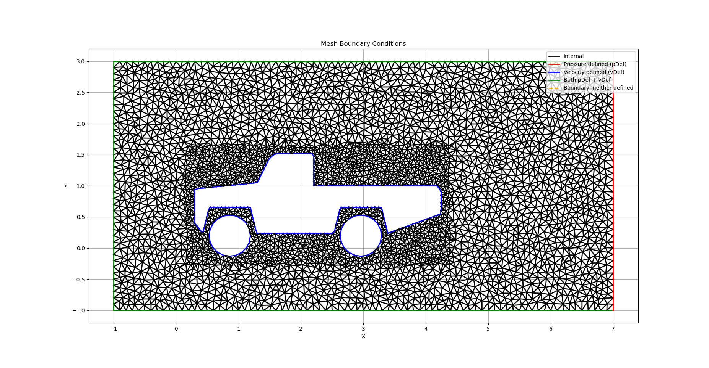
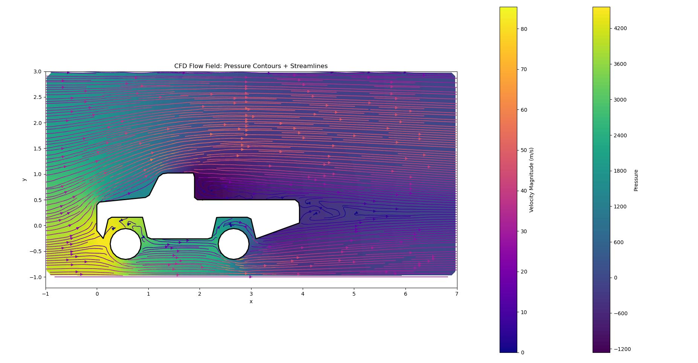

# 2D-Computational-Fluid-Dynamics-C-Library

A custom C++ implementation for simulating two-dimensional incompressible fluid flow around complex geometries using unstructured triangular meshes and the Finite Volume Method (FVM).

## Overview

This project implements a CFD simulation pipeline, from computational mesh generation to numerical solution of the Navier–Stokes equations. It combines Constrained Delaunay Triangulation (CDT), variable-density Poisson-disc sampling, and a semi-implicit pressure-linked predictor–corrector scheme.

The solver is designed to support multiple objects within a computational domain, with flexible mesh resolution and custom data structures for managing cells, edges, and boundary conditions.

## Features

- **Unstructured Mesh Generation:** Triangular meshes generated using Constrained Delaunay Triangulation.
- **Variable Mesh Density:** Poisson-disc sampling with spatially varying point spacing.
- **Multi-Object Support:** Mesh generation and simulation around multiple internal geometries.
- **Finite Volume Method:** Numerical discretization of the incompressible Navier–Stokes equations.
- **Pressure–Velocity Coupling:** Semi-implicit predictor–corrector solution procedure.
- **Linear Algebra:** Eigen for matrix operations and sparse linear-system computations.
- **Flow Analysis:** Visualization and analysis of pressure, velocity, and aerodynamic forces.

## Simulation Results

### Mesh Generation

| Unstructured Triangular Mesh | Multi-Object Mesh |
|---|---|
|  |  |

### Flow Field Visualization

The simulation results show the pressure distribution and velocity field around the geometry.



## Numerical Methodology

### 1. Mesh Generation

The computational domain is discretized into triangular control volumes. Poisson-disc sampling generates spatially distributed points with variable spacing, allowing mesh density to be adjusted across the domain. Constrained Delaunay Triangulation then constructs the mesh while respecting the prescribed geometric boundaries.

### 2. Governing Equations

**Continuity Equation**

$$
\nabla \cdot \mathbf{u} = 0
$$

**Navier–Stokes Momentum Equation**
**Navier–Stokes Momentum Equation**

```math
\rho \left( \frac{\partial \mathbf{u}}{\partial t} + (\mathbf{u} \cdot \nabla)\mathbf{u} \right) = -\nabla p + \mu \nabla^2 \mathbf{u}
```
where:
- $\mathbf{u}$ is the velocity field.
- $p$ is the pressure field.
- $\rho$ is the fluid density.
- $\mu$ is the dynamic viscosity.
### 3. Finite Volume Solver

The governing equations are discretized over the mesh using the Finite Volume Method. The solver uses a staggered pressure–velocity arrangement and a semi-implicit pressure-linked predictor–corrector procedure to couple pressure and velocity and enforce mass conservation.

### 4. Linear Algebra

Eigen is used for matrix and vector operations and solving the linear systems arising from the discretized equations. C++ provides direct control over mesh data structures and numerical computation.

## Dependencies

- C++ compiler
- [Eigen](https://eigen.tuxfamily.org/)
- `tph_poisson` for Poisson-disc sampling

## Getting Started

Clone the repository:

Compile the solver, adjusting the source filename and dependency paths to match your setup:

```bash
g++ run.cpp -I./eigen-5.0.0 -o cfd
```

Run the executable:

```bash
./cfd
```

To Visualize the result:
run ```bash python plot_edges.py ``` to visualize the Constrained Delaunay Triangulated Mesh.
run ```bash python plot_cfd.py ``` to visualize the raw CFD velocity and pressure at each cell.
run ```bash python streamline.py ``` to visualize the smoothened pressure and velocity feild round a object.

## Project Structure

```text
CFD-Solver/
├── src/
│   └── cfd_algo_1.cpp
|   └── run.cpp
|   └── plot_edges.py
|   └── plot_cfd.py
|   └── streamline.py
├── docs/
│   └── images/
│       ├── CLARKY_mesh.png
│       ├── Car_mesh.png
│       ├── Pickup_Dynamics.png
├── examples/
├── README.md
```

## Future Work

Potential improvements include mesh-convergence studies, validation against established CFD benchmarks, improved solver convergence, parallelization of computationally intensive operations, to allow the solver to tackle compressible fluid also, and to finally allow the code to extend to 3D.

## Acknowledgements

This project uses Eigen for linear algebra and `tph_poisson` for Poisson-disc sampling and the blog post from [Tom-Robin Teschner](https://cfd.university/learn/10-key-concepts-everyone-must-understand-in-cfd). Refer to the respective upstream projects for licensing and attribution requirements.
